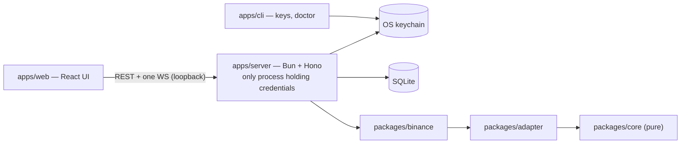
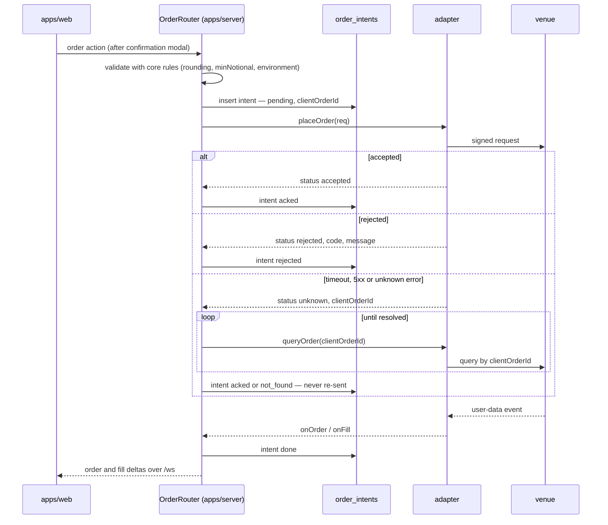

# Architecture

Status: design (M0). Nothing here runs yet; each section names the milestone that implements it.
Venue facts (endpoints, limits, URLs) live in `docs/venues/binance.md` with their sources; this
document only fixes the shape of the system.

## 1. Overview

tradedeck is a single-user terminal that runs on the owner's machine. One process —
`apps/server` — holds the venue credentials, keeps one session per exchange account, merges REST
snapshots and private streams into an in-memory state store, and pushes that state to the browser
over one WebSocket. The browser never holds a credential and never talks to a venue. From M2 the
browser also sends order intents, which the server validates, persists and executes.



## 2. Workspace layout

Bun workspaces, npm scope `@tradedeck/*`:

```
apps/server      @tradedeck/server   credentials, venue sessions, state store, OrderRouter (M2), API
apps/web         @tradedeck/web      React UI; talks only to apps/server
apps/cli         @tradedeck/cli      keys add|list|remove, doctor
packages/core    @tradedeck/core     pure: domain types, decimal rules, PnL, avg cost, protocol schemas
packages/adapter @tradedeck/adapter  ExchangeAdapter interface, capabilities, transport
packages/binance @tradedeck/binance  Binance spot + USDⓈ-M adapter (live + demo)
packages/db      @tradedeck/db       Drizzle schema, migrations, client
packages/secrets @tradedeck/secrets  SecretStore interface + keychain implementation
```

Import direction (enforced by `test/workspace.test.ts` in M1 issue 1, from the dependencies each
`package.json` declares):

```
packages/core     → (nothing)
packages/adapter  → core
packages/binance  → adapter, core
packages/db       → core (types only)
packages/secrets  → core (types only)
apps/server       → core, adapter, binance, db, secrets
apps/cli          → core, adapter, binance, db, secrets
apps/web          → core
```

`apps/web` reaching `adapter`, `binance`, `db` or `secrets` is forbidden. Each later venue is its
own package (`packages/bybit`, `packages/hyperliquid`, …) with the same edges as
`packages/binance`, so venue-specific dependencies (EIP-712 signing, Lighter's Go→WASM signer) stay
isolated in the package that needs them.

`packages/core/src` imports nothing from `bun`, `bun:*` or `node:*`, performs no I/O and receives
the clock as a parameter; that is what lets `apps/web` import it.

## 3. Process model

- `apps/server` listens on `127.0.0.1:8790` — never `0.0.0.0`, never a LAN address.
- Development: the Vite dev server on `localhost:5173` proxies `/api` and `/ws` to the server. Both
  proxy entries set `changeOrigin: true` (so the forwarded `Host` is `127.0.0.1:8790`) and `/ws`
  sets `ws: true`. The browser's `Origin` stays `http://localhost:5173`, which the guard allows.
- Production: `apps/web` is built once and served by `apps/server` from the same origin.
- **Loopback guard** — middleware in front of every route, the WebSocket upgrade included:
  - `403` when `Host` ∉ {`127.0.0.1:8790`, `localhost:8790`};
  - `403` when `Origin` is present and ∉ {`http://127.0.0.1:8790`, `http://localhost:8790`,
    `http://localhost:5173`, `http://127.0.0.1:5173`}.

  This is the DNS-rebinding and CSRF defence for a local API that will place orders: a hostile web
  page can make the browser reach `127.0.0.1`, but it cannot forge the `Host` it was loaded under or
  the `Origin` the browser attaches. The server emits no CORS headers.
- Threat model: the machine and its logged-in user are trusted (the keychain makes the same
  assumption). There is no in-app login; deployment beyond loopback is deferred and will add an
  edge gate before it happens (`docs/milestones.md`, Later).

## 4. Domain model

Implemented in `packages/core` (M1 issue 2). Every price, quantity and money amount is a decimal
**string** matching `^-?\d+(\.\d+)?$` (no exponent, `+` or bare dot); arithmetic happens in
`decimal.js`, never on JS numbers. Absent values are `null` end to end and render as "—" — never a
zero placeholder. Each type below is inferred from a strict Zod schema of the same name plus
`Schema` (`Position` ← `PositionSchema`); an unknown key fails validation.

```ts
type Venue = 'binance';                       // grows per venue package
type Environment = 'live' | 'demo';
type InstrumentKind = 'spot' | 'linear' | 'inverse';
// Binance USDⓈ-M = 'linear'. M1–M3 implement 'spot' and 'linear' only.

type InstrumentId = `${Venue}:${InstrumentKind}:${string}`; // e.g. "binance:linear:BTCUSDT"

type PriceRule =
  | { kind: 'tick'; tick: string }                                  // Binance, Bybit, Aster
  | { kind: 'sigfig'; sigFigs: number; maxDecimals: number };       // Hyperliquid

type QtyRule = { step: string; marketStep: string; minQty: string };

// Rules are plain data so they serialize to the UI. Core exports:
//   roundPrice(rule, price, side)  buy → round down, sell → round up:
//                                  the user never pays worse than typed;
//                                  throws if a buy would round to zero
//   roundQty(rule, qty)            always round down
//   notional(qty, price)

interface Instrument {
  id: InstrumentId;
  venue: Venue;
  kind: InstrumentKind;
  symbol: string;              // venue symbol, e.g. "BTCUSDT"
  base: string;
  quote: string;
  settle: string | null;       // null for spot
  priceRule: PriceRule;
  qtyRule: QtyRule;
  minNotional: string;
  maxLeverage: number | null;  // null for spot
}

interface Balance {
  accountId: string;
  scope: 'spot' | 'derivs' | 'unified';
  asset: string;
  free: string;
  locked: string;
  total: string;
}

interface Position {
  accountId: string;
  instrumentId: InstrumentId;
  side: 'long' | 'short';
  positionSide: 'both' | 'long' | 'short';  // 'both' = one-way mode
  size: string;                             // never negative; direction is `side`
  entryPrice: string;
  markPrice: string;
  liquidationPrice: string | null;
  unrealizedPnl: string;
  leverage: number;
  marginMode: 'cross' | 'isolated';
  updatedAt: number;                        // venue event time, ms
}

interface Order {
  accountId: string;
  instrumentId: InstrumentId;
  venueOrderId: string;                     // opaque; algo orders use the algo id
  clientOrderId: string;
  side: 'buy' | 'sell';
  type: 'market' | 'limit' | 'stop_market' | 'stop_limit' | 'take_profit_market'
      | 'take_profit_limit' | 'trailing_stop_market';
  status: 'new' | 'partially_filled' | 'filled' | 'canceled' | 'rejected' | 'expired'
        | 'triggered';
  qty: string;
  filledQty: string;
  price: string | null;
  triggerPrice: string | null;
  reduceOnly: boolean;
  timeInForce: 'gtc' | 'ioc' | 'fok' | 'post_only' | 'gtd';  // gtd: futures Good-Till-Date
  positionSide: 'both' | 'long' | 'short';
  createdAt: number;
  updatedAt: number;
}

interface Fill {
  accountId: string;
  instrumentId: InstrumentId;
  venueTradeId: string;
  venueOrderId: string;
  side: 'buy' | 'sell';
  qty: string;
  price: string;
  fee: string;
  feeAsset: string;
  realizedPnl: string | null;               // null for spot
  ts: number;
}

interface AccountSnapshot {
  accountId: string;
  balances: Balance[];
  positions: Position[];
  openOrders: Order[];                      // conditional (algo) orders included
  fetchedAt: number;
}

interface PriceUpdate {                     // subscribePrices callback and the `price` message
  instrumentId: InstrumentId;
  price: string;
  kind: 'mark' | 'last';                    // futures mark, spot last
  ts: number;
}

type AccountStatus = 'connecting' | 'live' | 'resyncing' | 'down';
```

## 5. ExchangeAdapter interface

Defined in `packages/adapter`, except `Credential` and `CredentialReport`, which live in
`packages/core` because `packages/secrets` may import only core. Members carry the milestone that
implements them; M1 code implements only the M1 members — no stubs for later ones.

```ts
interface ExchangeAdapter {
  // ── M1: read ──────────────────────────────────────────────────────────
  readonly venue: Venue;
  readonly capabilities: Partial<Record<InstrumentKind, KindCapabilities>>;
  verifyCredential(): Promise<CredentialReport>;
  loadInstruments(kinds: InstrumentKind[]): Promise<Instrument[]>;
  fetchSnapshot(): Promise<AccountSnapshot>;
  subscribe(handlers: {
    onBalance(b: Balance): void;
    onPosition(p: Position): void;
    onOrder(o: Order): void;
    onFill(f: Fill): void;
    onStatus(s: AccountStatus): void;
  }): () => void;                                         // returns unsubscribe
  subscribePrices(instrumentIds: InstrumentId[], onPrice: (p: PriceUpdate) => void): () => void;
  fetchFills(instrumentId: InstrumentId, sinceTs: number): Promise<Fill[]>;

  // ── M2: trade ─────────────────────────────────────────────────────────
  placeOrder(req: OrderRequest): Promise<OrderAck>;
  amendOrder(req: { instrumentId: InstrumentId; clientOrderId: string; qty: string; price: string }): Promise<OrderAck>;
  cancelOrder(req: { instrumentId: InstrumentId; clientOrderId: string }): Promise<OrderAck>;
  cancelAll(scope: { instrumentId: InstrumentId }): Promise<OrderAck[]>;
  queryOrder(req: { instrumentId: InstrumentId; clientOrderId: string }): Promise<Order | null>;
  setLeverage(instrumentId: InstrumentId, leverage: number): Promise<void>;
  setMarginMode(instrumentId: InstrumentId, mode: 'cross' | 'isolated'): Promise<void>;
}

interface CredentialReport {
  canRead: boolean;
  canTradeSpot: boolean;
  canTradeDerivs: boolean;
  canWithdraw: boolean;
  ipRestricted: boolean;
}

// M2
interface OrderRequest {
  instrumentId: InstrumentId;
  clientOrderId: string;
  side: 'buy' | 'sell';
  type: Order['type'];
  qty: string;                 // already rounded by core
  price: string | null;
  triggerPrice: string | null;
  timeInForce: Order['timeInForce'];
  reduceOnly: boolean;
  positionSide: Order['positionSide'];
}

// An ack is never treated as a fill; fills arrive through subscribe().
type OrderAck =
  | { status: 'accepted'; order: Order }
  | { status: 'rejected'; code: string; message: string }
  | { status: 'unknown'; clientOrderId: string };

type Credential =
  | { kind: 'ed25519'; apiKey: string; privateKeyPem: string }  // Binance default
  | { kind: 'hmac'; apiKey: string; secret: string };
// Future kinds, added with their venue: 'rsa' (Bybit), 'evm_agent' (Hyperliquid, Aster V3),
// 'zk_api_key' (Lighter). See docs/venues/upcoming.md.

interface KindCapabilities {
  amend: 'native' | 'limit_only' | 'qty_down_or_cancel_replace' | 'none';
  cancelAll: 'native' | 'per_symbol' | 'emulated';
  closePosition: 'native' | 'emulated';
  hedgeMode: boolean;
  batchMax: number;
  conditionalOrders: 'inline' | 'separate_api' | 'none';
}

// The members M1 has implemented so far; it widens to ExchangeAdapter once
// subscribe (M1 issue 7), subscribePrices (8) and fetchFills (12) land.
type BinanceAdapter = Pick<ExchangeAdapter,
  'venue' | 'capabilities' | 'verifyCredential' | 'loadInstruments' | 'fetchSnapshot'>;

declare function createBinanceAdapter(opts: {
  accountId: string;              // stamped on every balance, position and order
  environment: Environment;
  credential: Credential;
  fetch?: Fetch;                  // injected in tests; (url, init) => Promise<Response>
  now?: () => number;             // injected clock
  // WebSocket? is added by M1 issue 7, the first member that opens a socket.
}): BinanceAdapter;
```

Binance values:

| Kind | amend | cancelAll | closePosition | hedgeMode | batchMax | conditionalOrders |
|---|---|---|---|---|---|---|
| `spot` | `qty_down_or_cancel_replace` | `per_symbol` | `emulated` | `false` | 1 | `inline` |
| `linear` | `limit_only` | `per_symbol` | `emulated` | `true` | 5 | `separate_api` |

Binance `verifyCredential()` on `live` reads `GET /sapi/v1/account/apiRestrictions` and maps
`enableReading` → `canRead`, `enableSpotAndMarginTrading` → `canTradeSpot`, `enableFutures` →
`canTradeDerivs`, `enableWithdrawals` → `canWithdraw`, `ipRestrict` → `ipRestricted`. Every field
is optional in Binance's own types: a missing `enableWithdrawals` counts as `true`, so `keys add`
refuses the key, and any other missing flag counts as `false`. Demo serves no `/sapi` (404), so
on `demo` the report comes from `GET /api/v3/account` and `GET /fapi/v1/accountConfig`
(`docs/venues/binance.md`, Credential check).

The terminal composes what a venue lacks from the capability flags — e.g. close-all as one
reduce-only order per position, cancel-all as one call per symbol — instead of each adapter
pretending to support it.

### Transport

`packages/adapter` also holds the venue-neutral transport the venue packages build on. It names no
venue: base URLs, the API-key header and the server-time endpoint come from the venue package.

- **Signer** (`createSigner(credential)`): HMAC-SHA256 → lowercase hex; Ed25519 → base64 over the
  UTF-8 payload. The PEM is parsed once; an unparseable or non-Ed25519 PEM throws a fixed message
  that echoes no key material. The secret lives only in a closure, so no property of a signer
  carries it.
- **REST client** (`createRestClient`): query-signed scheme — every parameter in the query string,
  no body. A `signed` request appends `recvWindow` (default 5000) and `timestamp` from the server
  clock, signs that exact query and appends the percent-encoded `signature`; an `apiKey` request
  sends only the key header. `fetch` is injectable. Each request times out after 10 s by default,
  response body included. The parsed JSON is returned as `unknown`; Zod validation belongs to the
  venue package.
- **`VenueError`**: `kind` (`http` | `network` | `timeout` | `decode`), `method`, the bare `path`,
  `status`, the venue `code` as a string and `retryAfterMs` (from `Retry-After` on 429/418). Neither
  the message nor any field carries the query, headers, API key or signature: a `network` error
  keeps only the system error code (e.g. `ECONNREFUSED`), never the fetch error's message or the
  error itself. A `timeout` leaves the outcome unknown.
- **No automatic retries** anywhere in the transport; the caller decides (hard rule 5, and Binance
  requires backing off after a 429).
- **Server clock** (`createServerClock`): offset = server time − midpoint of the local request
  window. It resyncs after `maxAgeMs` (default 30 min) or `invalidate()` (e.g. on Binance `-1021`);
  concurrent callers share one sync, a sync already in flight when `invalidate()` runs does not
  count, and a failed sync leaves the clock unsynced.
- **Reconnecting socket** (`createReconnectingSocket`): injectable `WebSocket`, clock and random;
  the URL is resolved again before every connect (a fresh listen key); statuses `connecting` /
  `open` / `closed` with `retryInMs`. The delay uses equal jitter: `cap = min(maxDelay, initialDelay
  × 2^attempt)`, delay uniform in `[cap/2, cap]` (defaults 1 s and 30 s). The backoff resets only
  after a connection stayed open `stableAfterMs` (default 30 s): a private stream may be silent for
  long, and detecting a silently dead stream belongs to the resync (§6). `close()` is final.

## 6. Streaming & state

- Session start (per account): `fetchSnapshot()`, then `subscribe()`. Status goes `connecting` →
  `live`.
- On any private-stream disconnect the account goes `resyncing`; once the stream is back, a fresh
  REST snapshot **replaces** the account's state and the status returns to `live`. A resync never
  merges into old state. If reconnecting keeps failing, the status is `down` until it succeeds.
- Events are applied in venue event-time order (Binance `E`); an event older than the state it
  would overwrite is dropped.
- A position with size `"0"` is removed; an order reaching a terminal status (`filled`,
  `canceled`, `rejected`, `expired`) leaves the open-orders list.
- Prices: `subscribePrices` covers every instrument the account holds or has an order on —
  futures mark price, spot last price against USDT. uPnL is recomputed in core from the mark
  stream: long `(mark − entry) × size`, short `(entry − mark) × size`. Spot holding value is
  `total × last`.
- The UI shows per-account status and a "stale" badge on every row of an account whose status is
  not `live`.

## 7. Server ↔ UI protocol

Zod schemas in `packages/core/src/protocol.ts`; the server validates what it sends and the web app
parses what it receives with the same schemas.

- `GET /api/state` → `StateSnapshot`:

  ```ts
  interface StateSnapshot {
    accounts: { id: string; label: string; venue: Venue; environment: Environment; status: AccountStatus }[];
    instruments: Instrument[];        // only instruments referenced by the snapshots
    snapshots: AccountSnapshot[];
  }
  ```

- WebSocket `/ws`, server → client, discriminated on `type`:

  ```ts
  type ServerMessage =
    | { type: 'snapshot'; state: StateSnapshot }      // on connect and after every resync
    | { type: 'balance'; balance: Balance }
    | { type: 'position'; position: Position }
    | { type: 'order'; order: Order }
    | { type: 'fill'; fill: Fill }
    | ({ type: 'price' } & PriceUpdate)
    | { type: 'account_status'; accountId: string; status: AccountStatus };
  ```

- The web app keeps this state in a Zustand store with per-field selectors; it has no other data
  source in M1. Order intents (M2) are REST `POST`s whose results arrive back over `/ws`.

## 8. Order lifecycle (M2)



Fixed choices:

- `clientOrderId = "td-" + Date.now().toString(36) + "-" + 4 random base36 chars` — at most 36
  characters and matches Binance's `^[\.A-Z\:/a-z0-9_-]{1,36}$`. The server generates it with the
  injected clock.
- `queryOrder` retries with backoff for a bounded window. An order still unknown after it is
  marked `not_found` and shown to the user; nothing re-sends automatically.
- In M2 the server refuses every order action on a `live` account (hard rule 7).
- Partial close = percent of size rounded DOWN to `qtyRule.marketStep`, sent as a reduce-only
  MARKET order (hedge mode: the position's `positionSide` with the opposite side).
- Close-all = one reduce-only MARKET per open position, sent via `/fapi/v1/batchOrders` in chunks
  of 5; the result is reported per position. Binance has no close-all endpoint.
- Amend:
  - futures LIMIT → `PUT /fapi/v1/order`, sending both quantity and price;
  - spot quantity down → `PUT /api/v3/order/amend/keepPriority`;
  - spot price change → `POST /api/v3/order/cancelReplace` with `STOP_ON_FAILURE`.
- Futures TP/SL live in the Algo API (`/fapi/v1/algoOrder`); `/fapi/v1/order` rejects conditional
  types with `-4120`. An untriggered algo order cannot be modified, so editing one is cancel +
  place.
- Every order shows a confirmation modal: side, quantity, estimated notional, estimated fee. Fee
  rate source is settled in M2 — candidates are spot `GET /api/v3/account/commission` and futures
  `GET /fapi/v1/commissionRate` (both present in Binance's official connector; response mapping
  to be verified).

## 9. Secrets & key onboarding

```ts
interface SecretStore {
  get(accountId: string): Promise<Credential | null>;
  set(accountId: string, credential: Credential): Promise<void>;
  delete(accountId: string): Promise<boolean>;
}
```

- `KeychainSecretStore` (in `packages/secrets`) is the only file that touches `Bun.secrets`
  (experimental since Bun 1.2.21): service `tradedeck`, name = accountId, value =
  `JSON.stringify(credential)`. A headless server deployment later adds another implementation;
  `Bun.secrets` documents no headless fallback.
- Only `apps/server` and `apps/cli` construct a `SecretStore`. Credentials are never logged,
  persisted elsewhere, or sent to the browser.

Onboarding (M1 issue 9):

```
bun run cli -- keys add --venue binance --env live|demo --label <label> [--kind hmac]
```

1. Default `ed25519`: the CLI generates the keypair in memory and prints only the **public** key
   PEM, to paste into Binance's "Self-generated" API-key form. It then reads the API key from a
   hidden prompt. The private key never touches disk or the clipboard.
2. `--kind hmac`: reads API key and secret from hidden prompts.
3. Runs `verifyCredential()` and prints the report.
4. Refuses when `canWithdraw` is true — nothing is stored.
5. Writes the `accounts` row and stores the credential; if either write fails, the other is
   rolled back.

`keys list` prints label, venue, environment, credential kind and creation time — never key
material. `keys remove <label>` deletes the keychain entry and the account (its `fills` cascade).

Permissions per milestone: M1 "Enable Reading" only; M2 Demo keys add trading; M3 live keys add
"Enable Spot & Margin Trading" / "Enable Futures". An IP whitelist is recommended whenever the user
has a static IP.

## 10. Persistence

- Database file `~/.local/share/tradedeck/tradedeck.db`, override with `TRADEDECK_DB_PATH`; WAL
  mode; migrations auto-apply on open.
- Decimal columns are `TEXT`.
- M1 tables:
  - `accounts (id TEXT PK, venue, label UNIQUE, environment, credential_kind, created_at)`
  - `fills (account_id → accounts.id ON DELETE CASCADE, instrument_id, venue_trade_id,
    venue_order_id, side, qty, price, fee, fee_asset, realized_pnl NULL, ts,
    PK(account_id, instrument_id, venue_trade_id))`
- M2 adds `order_intents`; M3 adds `accounts.trading_enabled`.
- The own fills ledger exists because Binance keeps futures trade and income history for only 3
  months and has no spot average-cost endpoint. Spot average cost is `null` unless the ledger
  quantity equals the balance within one step.
- No credential, listenKey or signature is ever written to the database.

## 11. Testing

- `packages/core`: a test for every exported function; known-value fixtures for rounding (tick,
  step, sigfig, side direction), uPnL and average cost.
- Adapters: injected `fetch` replaying recordings from `packages/<venue>/__recordings__/` with
  `X-MBX-APIKEY`, `signature`, `listenKey` and `apiKey` values scrubbed; streams against a local
  fake WS server (`Bun.serve({ websocket })`) scripted per test.
- Live smoke runs only against Binance Demo, manually. Development and CI never call live venue
  endpoints.
- `test/workspace.test.ts` enforces the import graph of §2.

## 12. Venue environments

Copied from `docs/venues/binance.md` (sources there). Demo is authoritative for futures testing.

| Environment | Spot REST | Spot WS API | Spot market streams | USDⓈ-M REST | USDⓈ-M streams |
|---|---|---|---|---|---|
| `live` | `https://api.binance.com` | `wss://ws-api.binance.com:443/ws-api/v3` | `wss://stream.binance.com:9443` | `https://fapi.binance.com` | `wss://fstream.binance.com` — private `/private/ws/<listenKey>`, market under `/market` and `/public` |
| `demo` | `https://demo-api.binance.com` | `wss://demo-ws-api.binance.com/ws-api/v3` | `wss://demo-stream.binance.com` | `https://demo-fapi.binance.com` | `wss://demo-fstream.binance.com` |
